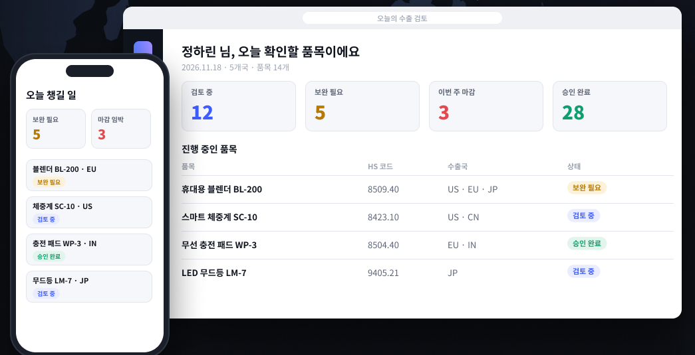
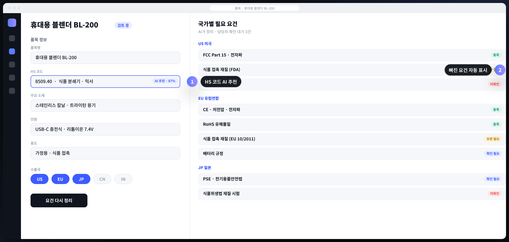
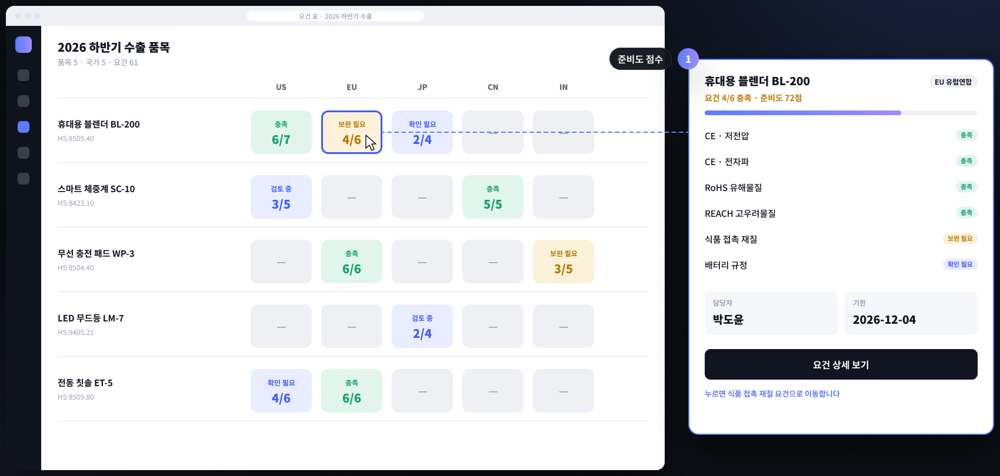
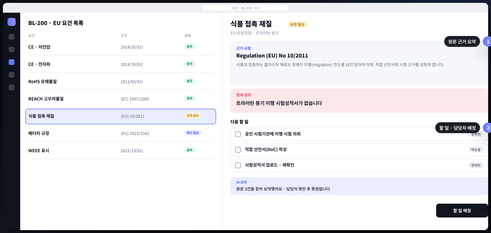
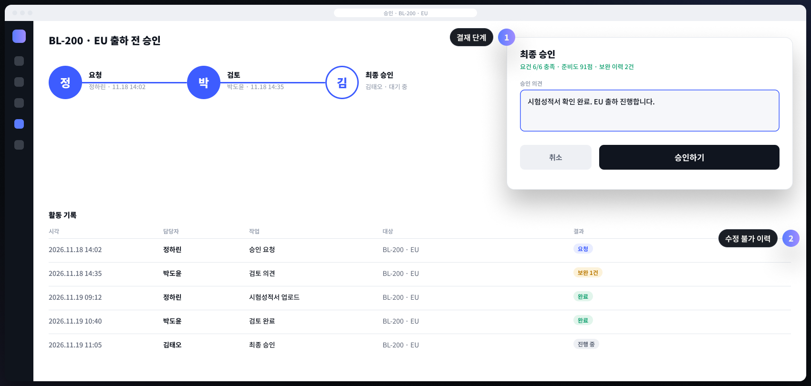
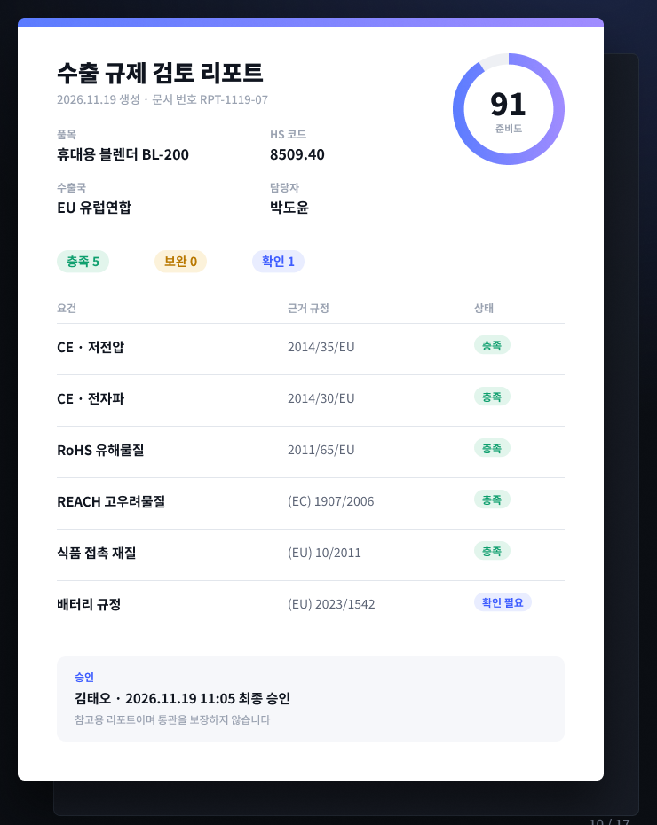
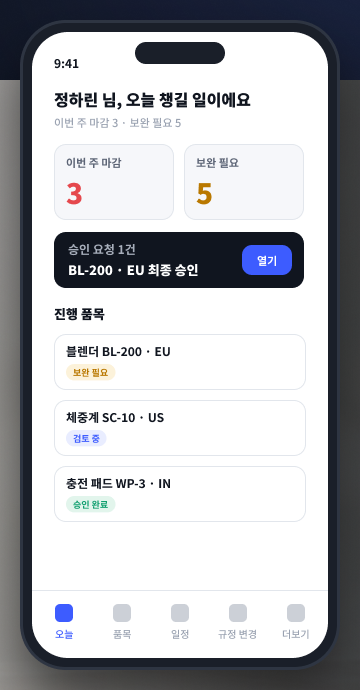

# export-check

중소 수출기업을 위한 **수출 규제 AI 검토** 도구입니다.
품목 정보를 한 번 입력하면 수출국별 인증 · 서류 · 표시 요건을 정리하고, 준비도 점수(0~100)와 국가별 리포트를 만듭니다.

> 이 저장소의 품목 · 회사 · 담당자 데이터는 모두 **가상 샘플**입니다. 리포트는 참고용이며 통관을 보장하지 않습니다.

## 화면

> 가상 샘플 데이터 화면입니다.

| 오늘의 검토 | 품목 등록 · HS 추천 |
|---|---|
|  |  |
| **품목 × 국가 요건 표** | **근거 규정 · 할 일** |
|  |  |
| **승인 · 이력** | **국가별 리포트** |
|  |  |

<p align="center"></p>

## 주요 기능

| 기능 | 설명 |
|---|---|
| HS 코드 추천 | 품목명 · 소재 · 전원 정보로 후보 3개 제시, 담당자가 확정 |
| 국가별 요건 매칭 | `rules/requirements_*.yaml` 요건표로 US · EU · JP · CN · IN 요건 정리 |
| 준비도 점수 | 인증 30 · 서류 25 · 유해물질 20 · 표시 15 · 개정 영향 10 가중합 |
| 근거 검색 | 수집한 고시 · 관보 조항을 하이브리드 검색해 원문 링크 표시 |
| 리포트 | 품목 × 국가 리포트, 승인 이력 포함 |

## 구조

```
export-check/
|-- web/            Vue 3 화면 (pages · components · stores)
|-- api/            FastAPI (routers · matching · scoring · rag · report)
|-- collectors/     국가별 고시 수집기 (us_ecfr · eu_eurlex · jp_meti · cn_samr · in_bis)
|-- rules/          requirements_{us,eu,jp,cn,in}.yaml
|-- data/sample/    가상 품목 20개 · 조항 요약 샘플
|-- tests/          pytest
`-- docker-compose.yml · Makefile
```

## 바로 실행 (화면만, 서버 없이)

```bash
cd web
npm install
npm run dev
```

브라우저에서 `http://localhost:5173` — 가상 샘플 데이터로 바로 동작합니다.
요건 화면에서 서류 칸을 체크하면 준비도 점수가 바뀌고, 승인하면 활동 기록에 남습니다 (새로고침하면 초기화).

## 전체 실행 (API 포함)

```bash
cp .env.example .env
make dev      # web 5173 · api 8000 (docker compose)
make test     # pytest
make seed     # 가상 품목 20개 불러오기
python -m collectors.run --dry   # 수집 대상만 출력
```

API 문서: `http://localhost:8000/docs`

## 기술 구성

- 화면: Vue 3 · Vite · TypeScript · Pinia
- API: Python 3.12 · FastAPI · Pydantic v2
- 검색: Qdrant (벡터) + 키워드 하이브리드
- 저장: MongoDB
- 수집: GitHub Actions 예약 실행 (베타 운영 시 활성화)

## 데이터 출처

eCFR · CPSC (미국), EUR-Lex (EU), METI (일본), SAMR (중국), BIS (인도), 관세청 HS 부호표.
번역본은 참고용이며 판단은 원문 기준입니다.

## 상태

배포 전 · 로컬 테스트 중 — 요건표 전문가 검수, HS 분류 정확도 개선, 파일럿 진행 예정.
